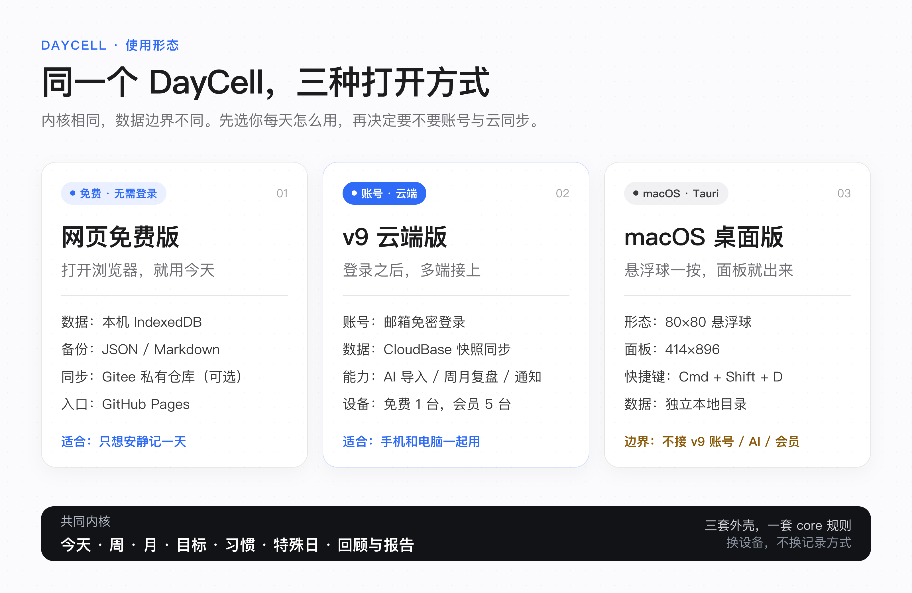
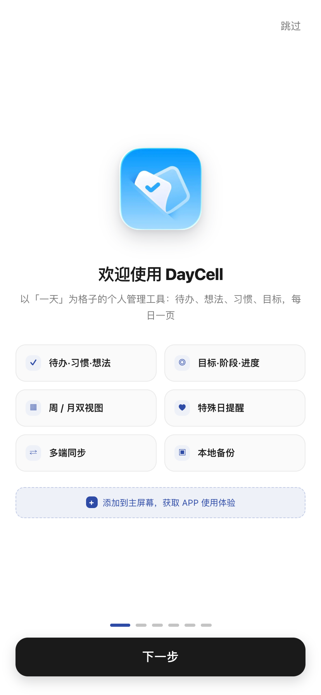
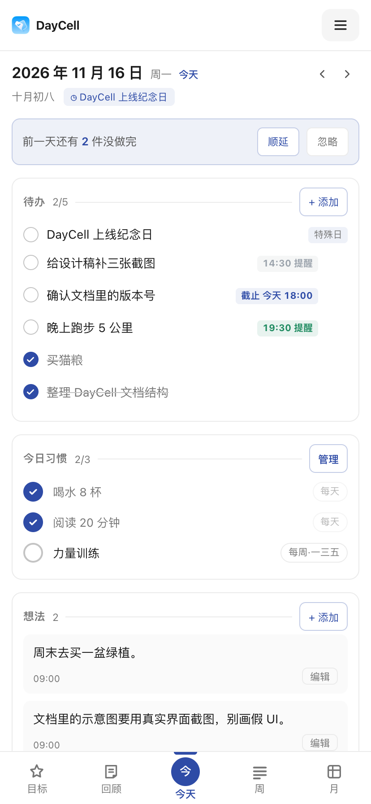
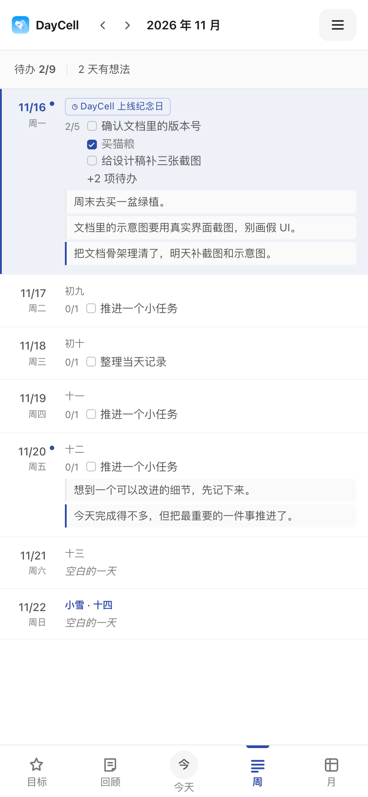
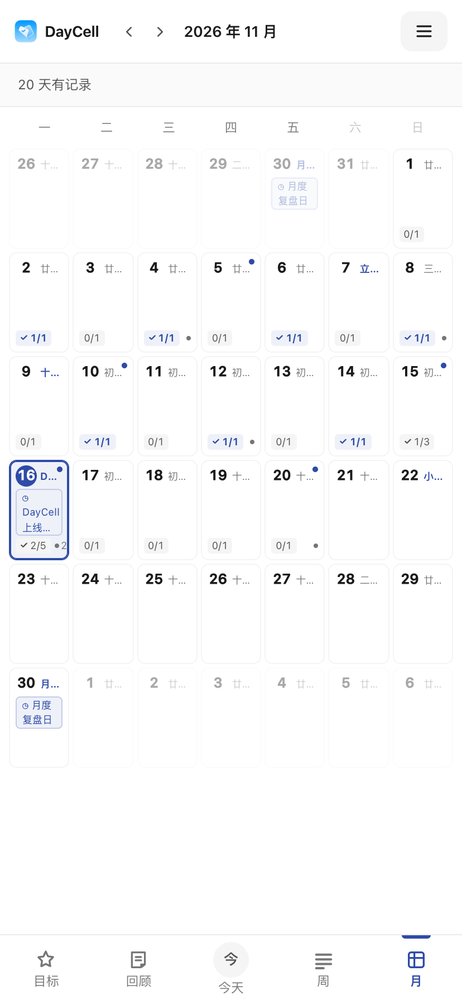
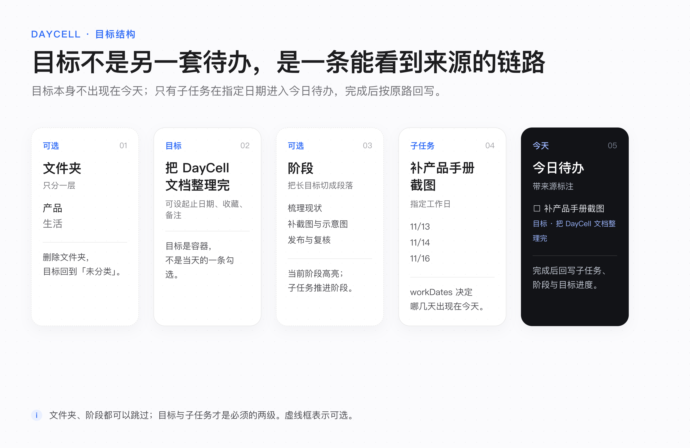
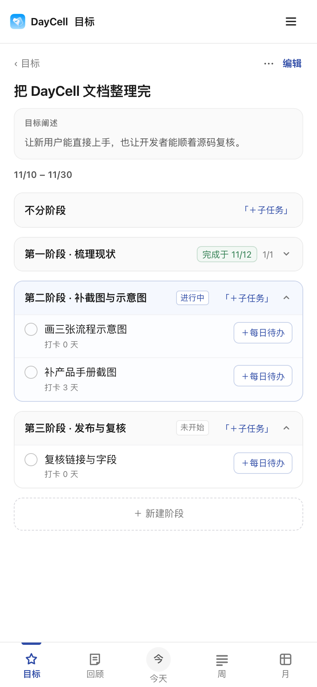
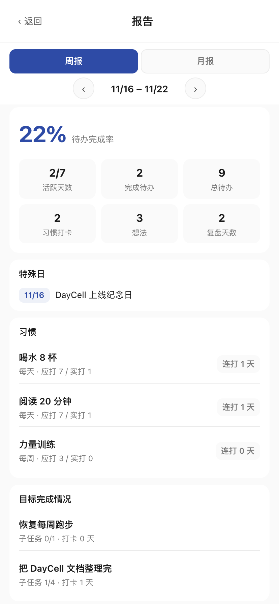
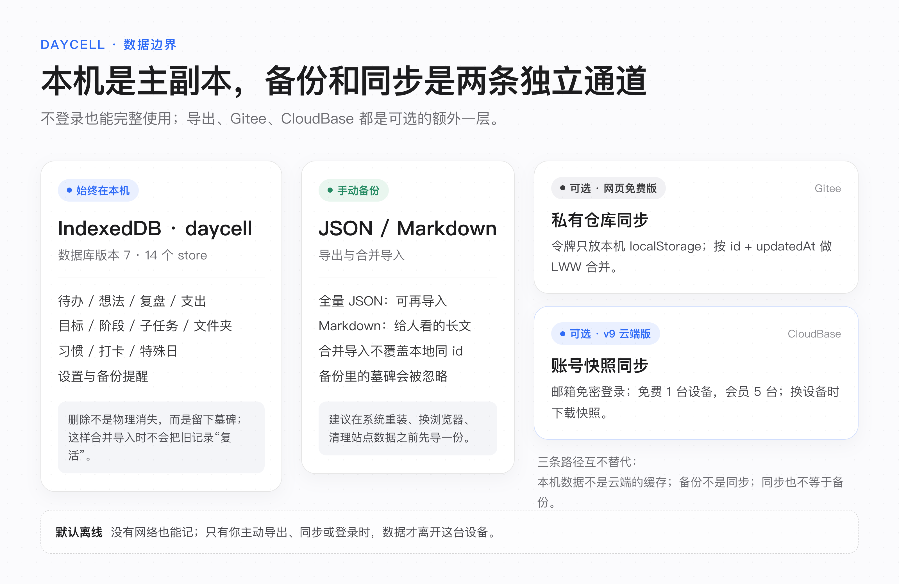
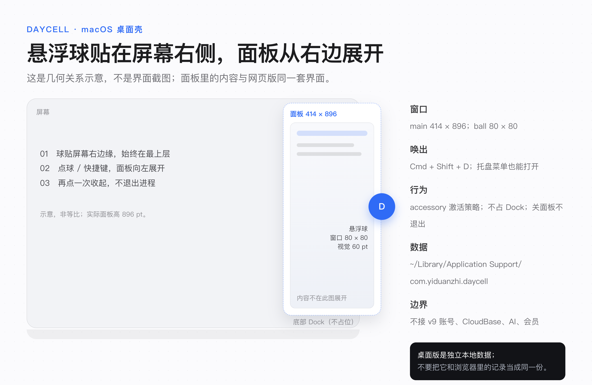

# DayCell 产品说明与使用手册

> 面向使用者。只讲“这是什么、能做什么、怎么操作”，不按 `main` / `v9-backend` / `feat/desktop-shell` 分支讲。
>
> 本文核对基线：当前工作区 `feat/desktop-shell`（HEAD `197bb52`）、`origin/v9-backend`（`579eef2`）、`origin/main`（`baaf5a5`），以及当前线上构建与桌面安装包。版本和入口见文末“版本与入口”。

> 图片说明：正文中标注“真实界面”的截图来自当前构建产物 + 演示数据，界面与当前产品一致，但内容不是你的真实记录；标注“示意图”的图片只解释结构与边界，不是应用截图。

## 一句话

DayCell 是一个以“一天”为格子的个人记录工具：待办、想法、习惯、目标、特殊日，一天一页；能装到手机主屏幕，也有 macOS 桌面悬浮球版本。

它不要求你先把人生规划清楚。今天想记什么就记什么，周视图和月视图负责把散落的记录重新排成一张可回看的表。

## 先分清三个使用形态

DayCell 目前有三个实际可用的形态。它们共用同一套前端界面和本地数据结构，但“账号 / 云同步 / AI / 会员 / 桌面壳”并不完全相同。

| | 网页免费版 | v9 云端版（免费账号 / 会员） | macOS 桌面版 |
|---|---|---|---|
| 怎么打开 | 浏览器访问 GitHub Pages | 浏览器访问 CloudBase 部署地址 | 安装 `DayCell.app` |
| 数据存哪 | 浏览器 IndexedDB | 本地 IndexedDB + CloudBase 云端快照 | 本机 WebView 存储，与浏览器隔离 |
| 账号 | 不需要 | 邮箱免密登录（邮箱 + 邮件验证码） | 不需要 v9 账号 |
| 云同步 | 可选：自己的 Gitee 私有仓库 | 登录后自动同步；也可手动上传 / 恢复 | 可选：自己的 Gitee 私有仓库 |
| AI 智能导入 | 无 | 有；免费账号累计试用 5 次，会员每天 100 次 | 无 |
| AI 周 / 月深度复盘 | 无 | 会员专属 | 无 |
| 通知 | 无 | 有；早间 / 晚间 / 周日周报 | 无 |
| 会员 / 兑换码 | 无 | 有 | 无 |
| 桌面悬浮球 | 无 | 无 | 有 |

*图 1：三种形态的边界对比。示意图，不是界面截图；具体入口和版本见文末。*

> 关键区别：**网页免费版和 macOS 桌面版不是 v9 云端版**。它们没有邮箱账号、CloudBase 自动云同步、AI 和会员；桌面版额外提供悬浮球和全局热键。
>
> 网页版与桌面版的数据是**两份独立存储**。想让两边内容一致，用“导出备份 / 导入备份”迁移一次，或各自配置 Gitee 同步。

## 产品是什么

### 一天一页

底部五个入口，从左到右是：

**目标 | 回顾 | 今天 | 周 | 月**

- **今天**：默认落地页。一天里的待办、想法、习惯、复盘都在这里。
- **周**：一周七行，看这一周每天有什么。
- **月**：一个 42 格的月历，只看密度和标记，不塞正文。
- **目标**：长期方向，按“目标 → 阶段 → 子任务”推进。
- **回顾**：所有想法和每日复盘，另有周 / 月报告入口。

### 三个时间尺度

- **今天**负责“现在要做什么”。
- **周**负责“这一周怎么排”。
- **月**负责“这个月发生了什么”。

三者不是三套数据，而是同一批记录的不同视角。今天写的一条待办，会同时出现在周和月里；在周 / 月点某一天，也能回到那一天的今天视图。

### 目标与今天分开

目标不直接塞进每日待办。一个目标可以拆成阶段，阶段下再挂子任务；在目标里点一次「＋ 目标推进」把某个子任务挑进来，它每天都会出现在今天的「目标推进」模块里，直到做完或点「每天推进中」移出。目标推进不混进待办列表，也不计入待办 0/N 的计数，长期方向因此不会把今天压垮。

### 数据优先在本地

免费网页版和桌面版都把数据存在本机。没有账号也能用，离线也能打开（PWA 安装后）。需要多设备时，可以配置自己的 Gitee 私有仓库，或使用 v9 的 CloudBase 云同步。

## 第一次使用

### 网页版 / 手机主屏幕

*图 2：首次打开会看到欢迎页；右上角“跳过”可直接进入，底部“下一步”逐屏看完。真实界面截图，演示环境。*

1. 用浏览器打开 DayCell 网页地址。
2. 想装成 App：
   - **iPhone / iPad**：Safari 打开 → 底部“分享”按钮 → “添加到主屏幕”。
   - **安卓**：Chrome 右上角“⋮” → “添加到主屏幕 / 安装应用”。
   - **电脑**：Chrome / Edge 地址栏右侧“安装”图标 → 安装 DayCell。
3. 装好后从主屏幕或桌面图标打开，界面全屏，数据仍在你的浏览器本地。

> 手机浏览器直接打开也能用；但通知、离线更新和“像 App 一样打开”的体验，安装到主屏幕更稳。

### v9 云端版

1. 打开 v9 部署地址。
2. 进入“账号与同步”或登录入口，填邮箱。
3. 收邮件验证码，输入后登录。
4. 登录后云同步会自动拉取 / 推送；也可以手动“立即上传”或“从云端恢复”。
5. 免费账号可直接用；会员在“账号”页查看状态、到期日和权益。

### macOS 桌面版

1. 双击 `DayCell_1.4.8_universal.dmg`，把 DayCell 拖进“应用程序”；DMG 打不开时用 ZIP。
2. 第一次双击会被 macOS 拦一次，这是个人开发者签名的正常拦截：
   - 弹窗点“完成”；
   - 打开“系统设置 → 隐私与安全性”，在“安全性”区域点“仍要打开”；
   - 输入开机密码，可能再点一次“打开”。
3. 装好后屏幕右缘出现白色悬浮球，点一下展开面板。
4. 详细图文步骤见 `release/DayCell-Mac安装指引.md`。

> 桌面版第一次打开是空的，这是正常的：它和浏览器版是两份独立存储。要迁移网页版数据，在网页版右上角菜单“导出备份”，再在桌面版右上角菜单“导入备份”。

## 今天视图

*图 3：今天视图。真实界面截图，演示数据；图中包含顺延横幅、定时 / 截止待办、今日习惯和想法。复盘区块在页面下方继续滚动可见。*

### 顶部日期

顶部显示年、月、日、星期；当天会标“今天”。左右按钮切换前一天 / 后一天。

### 顺延横幅

如果昨天有没完成、又不是截止型（DDL）的待办，今天顶部会出现顺延提示：

- **顺延**：把这些待办移到今天。
- **忽略**：保留在原日期，不搬过来。

截止型待办不参与顺延，它会自己每天置顶提醒，直到完成或删除。

### 待办

- 点“+ 添加”写一条待办。
- 可以只写文字，也可以设置时间、截止日期。
- 点待办文字就地编辑；勾选圆圈完成；完成后沉到底部。
- 设了具体时间的待办，时刻显示在文字前面（`09:00 交周报`），行尾只留一个「提醒」或「截止」小标签；没设时间就不显示时刻，不留空位。时刻和文字在同一条基线上。
- 带截止日期的待办：
  - 从设置截止日那天起出现在日视图，并置顶；
  - 未完成时每天提醒；但只有截止日当天时刻才挪到文字前面，更早的日子把日期和时刻一起留在行尾（`9/30 09:00 截止`），免得把「9/30 9 点截止」读成「今天 9 点要做」；
  - 逾期标红“已逾期 · 9/30 09:00 截止”；没设具体时间时写作“已逾期 · 9/30 截止”；
  - 完成当天仍显示勾选状态，次日从今天视图移除；
  - 没设具体时间的截止型待办走同一套标签：截止日当天只写「截止」，更早的日子写「11/19 截止」；
  - 不参与顺延。
- 从目标挑进「目标推进」的子任务不走普通待办：它们按目标分组出现在今天的「目标推进」模块，组头写目标名与「第N阶段 · 阶段名」，行首「打卡 / 已打卡」只记今天在它上面动过；行尾 6 格是「今天 + 过去 5 天」，最右一格就是今天，点完立刻变蓝。挑进来一次即每天自动出现，做完或点「每天推进中」移出后不再出现。

### 想法

随手记一段话，支持多行；点文字就地编辑。想法会按天汇总到“回顾”里。

### 今日习惯

只显示今天应该打卡的习惯，纯勾选，不进入待办列表。暂停的习惯不会出现。

### 每日复盘

今天视图最下方是“复盘”区块，一天一条。写完可以在“回顾 → 复盘”里按日期回看。

> 历史支出数据仍保留在旧数据里，但今天视图不再显示支出区块；DayCell 当前不承担记账主流程。

## 周视图

*图 4：周视图。真实界面截图，演示数据；七行一天，顶部是本周汇总。*

- 七行竖排，一行一天；顶部有本周汇总条。
- 每行显示待办前 3 条、想法前 2 条摘要；有复盘会显示复盘预览；逾期完成会留下痕迹。
- 支持“三页轨道”左右滑动：左滑下一周，右滑上一周；桌面和手机都保留左右箭头。
- 默认不在周视图里列习惯；需要的话去“右上角菜单 → 偏好设置”，打开“周视图显示习惯”。
- 点某一天可以进入那一天的今天视图。

## 月视图

*图 5：月视图。真实界面截图，演示数据；42 格只放指示器，不塞正文。*

- 7 列 × 恒 6 行 = 42 格；周一起始。
- 格内只放指示器，不放正文：
  - 特殊日徽章；
  - 待办进度 `✓done/total`；
  - 想法点；
  - 复盘点。
- 支持三页轨道左右滑动：左滑下一月，右滑上一月；也保留左右箭头。
- 邻月补齐格会淡化，但仍可点；点某一天回到那天的今天视图。

## 目标

### 结构

**目标 → 阶段（可选）→ 子任务 → 今日待办**

*图 6：目标链路。文件夹和阶段都可以跳过，只有子任务会在指定日期进入今日待办。*

- **目标**：标题、阐述、时间范围、收藏、完成、所属文件夹。
- **阶段**：名称、百分比、备注、进行中 / 已完成、当前阶段、完成归属日。
- **子任务**：标题、描述、进度、完成、打卡日期集合、所属阶段、加入今日待办。
- **今日待办**：子任务被手动加入当天后生成的待办；完成它会同步当天打卡，删除它会撤销加入和当天打卡。

*图 7：目标详情。真实界面截图，演示数据；阶段、子任务、打卡和“加入每日待办”都在这里。*

### 新建与编辑

- 目标可以只填时间范围的一侧（只填开始，或只填结束）。
- 一个目标可以有多个阶段；同一目标内“当前阶段”互斥，只有一个。
- 阶段可以手动标记完成；阶段下的子任务全部完成时，阶段会自动完成。
- 子任务可以填描述、进度百分比 / 进度文字，也可以只填其中一项。
- 子任务完成后沉到底部；已完成的子任务之间保持完成先后顺序。

### 文件夹

- 文件夹是一层扁平分类，可新建、重命名、收藏、折叠、删除。
- 目标可以归属某个文件夹；也可以不归属，落在“未分类”。
- 文件夹内已完成的目标默认折叠为一行“**已完成 N**”；点这一行可以展开查看。
- 每个文件夹独立记住展开 / 折叠状态，切换文件夹不会互相影响。
- 删除文件夹时，里面的目标**不会删除**，会自动移到未分类。

### 收藏与完成

- 目标可以点星标收藏；收藏目标在列表里置顶（多个收藏按收藏时间新的在前）。
- 已完成目标不参与收藏置顶。
- 目标完成后，在文件夹内默认折叠；不在文件夹里的目标按列表规则显示。

### 目标打卡

- 子任务有“打卡”按钮：当天打卡、可取消、跨天重置。
- 目标卡片会显示“已进行 N 天”，按子任务打卡日期去重并集计算。
- 打卡会自动写入当天复盘的一句话；取消打卡会自动移除；复盘变空会删除。

## 习惯

- 新建习惯：名称、频率。
- 频率支持：
  - 每天；
  - 每周固定星期几。
- 习惯是纯勾选，不进入待办。
- 暂停后不出现在今天视图；恢复后按频率继续。
- 打卡记录单独存，取消打卡会留下删除标记（墓碑），不会把历史弄乱。
- 习惯可以拖拽排序；排序会保存。

## 特殊日

- 支持一次性、每年、每月、每周。
- 一次性 / 每年可设农历（含闰月）；每月 / 每周只支持公历。
- 月视图格内显示徽章。
- 当天可以勾掉；勾选记录单独存，不影响特殊日本身。
- 特殊日设置入口：右上角菜单 → 特殊日设置。

## 回顾与报告

*图 8：周报。真实界面截图，演示数据；报告是本地统计，v9 会员另有 AI 深度复盘。*

### 想法

“回顾”页顶部是“想法 | 复盘”切换。想法按天分组、时间倒序，每页 10 条；可以收藏、置顶、就地编辑、删除。

### 复盘

一天一条，按日期倒序，每页 10 条；点条目进入对应日期的今天视图。

### 报告

“回顾”页在切换条下方有独立“报告”入口，进入全屏周 / 月报告。报告主体是纯本地统计，包含：

- 待办完成率、完成数、逾期 / 顺延；
- 习惯应打 / 实打 / 最长连续；
- 目标完成情况、子任务进度、打卡天数；
- 特殊日；
- 复盘天数；
- 待办在一周内的分布。

v9 云端版的报告额外有“AI 深度复盘”段：会员可生成六段分析（效率趋势、习惯警报、拖延信号、想法洞察、目标偏差、下周建议）；非会员显示“升级解锁”。

## 数据、备份与同步

*图 9：数据路径。本机是主副本；备份和同步是两条独立通道，三者互不替代。*

### 本地数据

- 网页版和桌面版的数据优先存在本机 IndexedDB（桌面版在 WebView 存储里）。
- 免费版没有账号，也不需要联网才能记录。
- 清除浏览器缓存 / 站点数据会清掉本地数据；换设备、清缓存前先导出备份。

### 导出备份

右上角菜单 → “导出备份”，得到一份 JSON。备份包含全部记录和设置，也包含删除标记（墓碑），用于完整还原现场。

### 导入备份

右上角菜单 → “导入备份”。导入是**合并**，不是清空覆盖：

- 本地没有的记录：补入；
- 本地已有的同一条记录：保留本地，不被旧备份覆盖；
- 本地已删除、备份里还活着的记录：会被恢复；
- 备份里的墓碑：不导入；
- 设置项：本地已有的 key 不覆盖，新 key 才补入。

### 一键导出 Markdown

右上角菜单 → “一键导出 MD”，可选本周 / 本月，导出可读的 Markdown 文本。它用于阅读和分享，不是完整备份；完整迁移请用 JSON 备份。

### Gitee 同步（免费网页版 / 桌面版）

1. 右上角菜单 → “同步设置”。
2. 填自己的 Gitee 用户名、仓库名、私人令牌。
3. 配置后自动拉取 + 变更推送；也可以手动“立即同步”。

注意：

- 数据只经过你自己的 Gitee 私有仓库中转。
- 令牌存在浏览器 localStorage，刻意不进 IndexedDB、不进备份文件；换设备要重新填。
- 同步合并按记录 id + `updatedAt` 做“最后写入者胜出”；删除也会通过墓碑同步。
- 同步不是备份。重要数据仍建议定期导出 JSON。

### v9 CloudBase 云同步

- 登录邮箱账号后自动同步；也可手动“立即上传”或“从云端恢复”。
- 客户端拉取时按记录 id + `updatedAt` 合并；上传时用整包快照覆盖云端。
- 云端只保存当前登录用户的最新快照。
- 设备限制：免费账号 1 台，会员最多 5 台；超限会上传失败并提示设备上限。
- 设备管理里可以查看已登记设备并解绑；解绑当前设备后，下次上传会重新登记。

> “从云端恢复”会以云端快照为准做合并；如果你在本地刚改了很多内容，先“立即上传”再恢复，避免把本地新改动盖掉。

## v9 云端版：账号、会员、AI、通知

### 邮箱免密登录

- 输入邮箱 → 收邮件验证码 → 输入验证码登录。
- 不需要密码。
- 登录态会尽量保持；长时间不打开后可能需要重新验证。

### 会员

- 会员判定：到期时间晚于当前时间。
- 会员权益：
  - 云同步设备上限从 1 台提高到 5 台；
  - AI 智能导入每天 100 次；
  - AI 周 / 月深度复盘；
  - 周日周报推送。
- 兑换码格式 `DC-XXXX-XXXX-XXXX`，一码一次；兑换码本身可配置 30 天或 365 天，当前购买页卖的是 30 天月卡。
- 续期从当前到期时刻顺延；到期后自动恢复免费版。
- 购买页当前标价月卡 ¥4.9 / 30 天；实际价格和购买入口以页面展示为准。
- 虚拟商品：兑换码一码一次激活，售出后不支持退款。

> 如果购买入口打不开，说明对应商品尚未正式上架；可以先用兑换码，或联系开发者。不要把代码里的占位购买链接当成已上架店铺。

### AI 智能导入

入口：今天视图待办区块的“✦”入口。

1. 输入一段话，或使用语音输入（浏览器支持时显示麦克风）。
2. AI 整理成四组：待办、习惯、想法、目标。
3. 进入预览：默认全勾，每条可以改文字、日期、时间、截止日期、频率；也可以取消勾选。
4. 点“确认导入”才写入；不确认不会改数据。
5. 配额由后端返回：免费账号累计试用 5 次；会员每天 100 次（按中国时区日期）；失败不消耗配额。

语音输入当前是浏览器 Web Speech 的 MVP；后端预留了腾讯云 ASR 接口，但未配置时语音识别不可用，会提示改用文字。

### AI 周 / 月深度复盘

- 入口：回顾 → 报告 → AI 深度复盘。
- 仅会员可用；非会员显示“升级解锁”，不扣配额。
- 六段：效率趋势、习惯警报、拖延信号、想法洞察、目标偏差、下周建议。
- 生成会消耗会员当天 AI 配额；失败不扣。

### 通知

入口：右上角菜单 → 通知设置（需登录）。

- 早间日报可选档位：07:30 / 08:00 / 08:30 / 09:00 / 09:30。
- 晚间日报可选档位：19:00–22:00，每半小时一档。
- 周日周报：每周日晚上；时间默认跟随晚间日报，可单独选；会员专属。
- 平台限制：
  - iPhone / iPad：先“添加到主屏幕”，从主屏图标打开；Safari 16.4+。
  - 安卓：安装 / 添加到主屏幕后通知才稳定。
  - 电脑：需要浏览器通知权限和 HTTPS。
- 关闭通知或设备失效时，会删除对应订阅。

### 设备管理

- 账号页可查看已登记设备。
- 免费 1 台，会员 5 台。
- 可解绑其他设备；解绑后该设备再上传会重新登记（如果额度允许）。

## macOS 桌面版

*图 10：悬浮球与面板的几何关系。示意图，不是界面截图；面板内容与网页版同一套界面，此处不展开。*

### 安装

- 推荐 DMG：`DayCell_1.4.8_universal.dmg`（10.4 MB）。
- 备用 ZIP：`DayCell-1.4.8-mac.zip`（9.7 MB）。
- 当前是 ad-hoc 深度签名，不是 Apple 公证签名；第一次打开会被 Gatekeeper 拦，按安装指引放行即可。
- 如果提示“已损坏”，在终端执行 `xattr -cr /Applications/DayCell.app` 后再打开。

### 悬浮球与面板

- 启动后屏幕右缘中部出现白色悬浮球。
- 点球 → 右侧滑出 414×896pt 面板，垂直居中。
- 球可以上下拖，松手记住位置；左右拖不动，永远贴右缘。
- 再点球、点面板外、或按热键可以收起。
- 面板可以跨 Space / 全屏应用显示。
- 小屏幕上面板会按比例缩小，避免超出屏幕。

### 宽窗模式

托盘菜单 → “切换宽窗模式”：宽度 820pt，高度为所在屏幕逻辑高度的 85%。适合月视图这类密集页面。

### 热键与托盘

- 全局热键：`Cmd+Shift+D` 展开 / 收起。
- 托盘菜单：展开 / 收起、切换宽窗模式、显示悬浮球、开机自启、退出 DayCell。
- 桌面版是 accessory 激活策略：不占 Dock；从菜单栏托盘图标操作。

### 数据

- 数据存在本机 WebView，路径约为 `~/Library/Application Support/com.yiduanzhi.daycell`。
- 与浏览器版完全独立。
- 迁移：网页版导出备份 → 桌面版导入备份；反向同理。
- 桌面版也可以用 Gitee 同步，但没有 v9 账号 / CloudBase / AI / 会员。
- 卸载：把“应用程序”里的 DayCell 拖进废纸篓；要清记录再删上面的数据目录。

## 快捷键

| 按键 | 作用 |
|---|---|
| `d` / `t` | 回到今天 |
| `w` | 周视图 |
| `m` | 月视图 |
| `g` | 目标 |
| `n` | 回顾 |
| `j` / `→` | 下一天 / 下一周 / 下一月 |
| `k` / `←` | 上一天 / 上一周 / 上一月 |
| `Esc` | 关闭覆盖层 / 返回 |

## 常见问题

### 为什么网页版和桌面版数据不一样？

它们是两份独立存储。用“导出备份 / 导入备份”迁移，或分别配置 Gitee 同步。

### 换手机 / 换电脑怎么搬数据？

先在旧设备“导出备份”，在新设备“导入备份”。如果两边都配置了同一个 Gitee 仓库，也可以等自动同步；但首次仍建议先备份。

### 清缓存后数据没了？

本地数据在浏览器 IndexedDB，清站点数据会删掉。只能从备份或云端 / Gitee 恢复。以后清缓存前先导出。

### 删除文件夹，目标会没吗？

不会。目标会自动移到“未分类”，只有文件夹本身被删除。

### 已完成目标去哪了？

在文件夹内默认折叠成一行“已完成 N”；点开可查看。每个文件夹独立记住展开状态。

### 带截止日期的待办为什么每天都在？

截止型待办未完成时会每天置顶提醒，直到完成或删除；它不参与顺延。完成当天仍显示，次日移除。

### 周视图为什么没有习惯？

默认关闭。右上角菜单 → 偏好设置 → 打开“周视图显示习惯”。

### v9 云同步会覆盖本地吗？

拉取时按记录级 `updatedAt` 合并，较新的胜出；上传时整包覆盖云端。删除通过墓碑同步。重要操作前先“立即上传”或导出备份。

### 免费账号能同步几台设备？

1 台。会员 5 台。超限会上传失败并提示设备上限。

### AI 导入次数怎么算？

免费账号累计 5 次；会员每天 100 次（中国时区日期）。失败不扣。AI 深度复盘只给会员，非会员不扣配额。

### 兑换码能重复用吗？

不能。一码一次；再次购买新码后从到期时刻顺延。

### iPhone 收不到通知？

先“添加到主屏幕”，从主屏图标打开；Safari 16.4+。普通 Safari 标签页里通知不生效。

### 桌面版小球不见了？

点菜单栏 DayCell 托盘图标 → 勾“显示悬浮球”。

### 桌面版提示“已损坏”？

执行 `xattr -cr /Applications/DayCell.app`，再打开。这是文件传输丢了签名标记，不是应用真的损坏。

## 版本与入口

| 形态 | 当前版本 | 入口 |
|---|---|---|
| 网页免费版 | v8.108 | `https://yiduanzhi-ops.github.io/DayCell/` |
| v9 云端版 | v9.62 | 当前 CloudBase 部署地址；入口以实际发给你的地址为准 |
| macOS 桌面版 | 1.4.8 | `release/DayCell_1.4.8_universal.dmg` / `release/DayCell-1.4.8-mac.zip` |

> 版本号可以在应用内“右上角菜单 → 版本更新”查看。本文不承诺未在代码或线上产物中出现的功能；如果界面与本文不一致，以当前应用内实际显示为准。

## 相关文档

- 开发者向：架构、数据模型、API、数据库、部署与分支差异，见 [`DayCell-开发文档.md`](DayCell-开发文档.md)。
- macOS 安装图文：`release/DayCell-Mac安装指引.md`。
- 历史资料：`docs/PRD.md`、`docs/CORE-API.md`、`docs/PROGRESS.md`、`docs/v9-roadmap.md`、`docs/adr/` 保留为历史记录，不作为当前功能事实来源。
