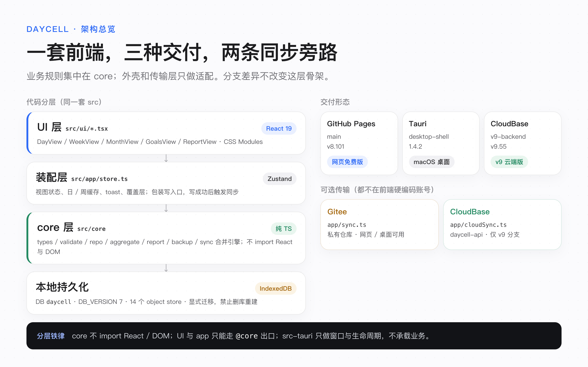
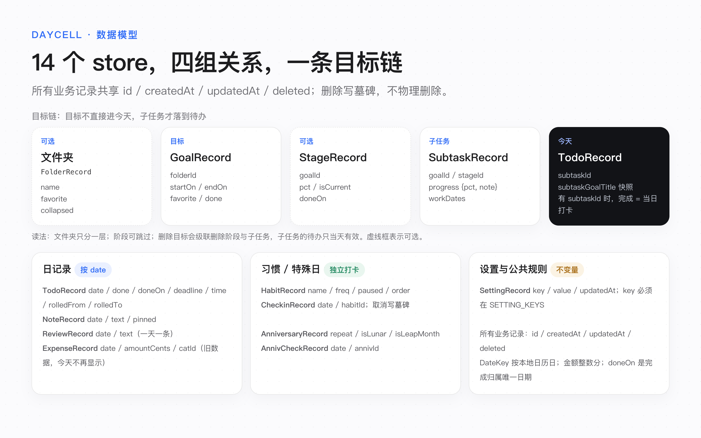
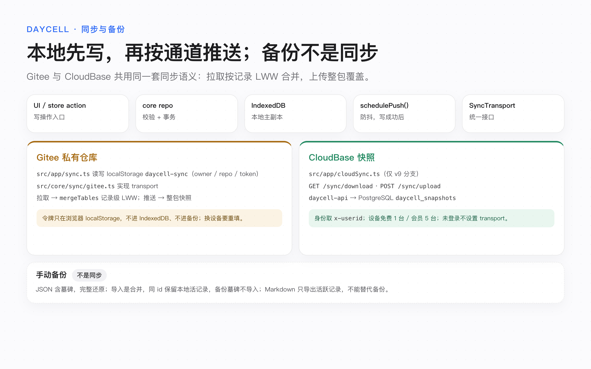
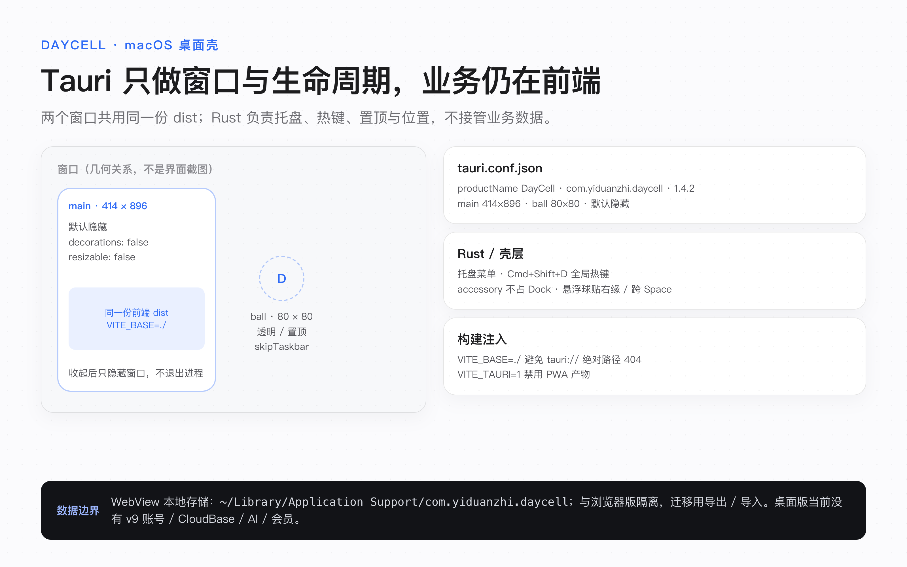
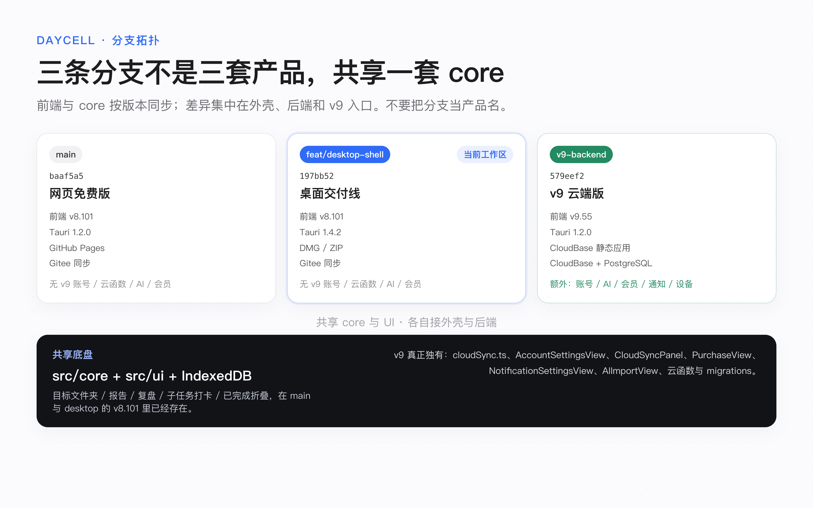

# DayCell 开发文档

> 面向开发者与维护者。描述当前代码、配置和实际产物的 as-built 状态，不写未来规划。
>
> 本文核对基线：`feat/desktop-shell` HEAD `197bb52`、`origin/main` `baaf5a5`、`origin/v9-backend` `579eef2`；线上 Pages 与 v9 部署、`release/` 安装包均已回读核验。下文未注明分支的“当前”均指 `feat/desktop-shell` 工作区；main / v9 的差异统一看 §8。
>
> 旧文档（`docs/PRD.md`、`docs/CORE-API.md`、`docs/PROGRESS.md`、`docs/v9-roadmap.md`、`docs/adr/`）保留为历史资料，**不再作为当前事实来源**。它们与现状的偏差见文末“旧文档偏差与已知缺口”。
>
> 图片说明：本文 5 张图都是 HTML/CSS 画的架构 / 数据 / 流程 / 桌面 / 分支示意图，不是产品界面截图；图中的路径、路由、表名、窗口尺寸均与正文和源码核对。

## 文档结构

| 想先弄清 | 直接看 |
|---|---|
| 系统边界、三种交付形态、两套同步通道 | §0–§1 |
| 代码分层、仓库职责、启动链路 | §1–§2 |
| 数据模型、14 个 store、字段与不变量 | §3 |
| 待办 / 目标 / 习惯 / 特殊日 / 复盘规则 | §4 |
| 前端技术栈、路由、构建注入、测试 | §5 |
| v9 路由、数据库、会员、AI、Web Push | §6 |
| macOS 桌面壳的窗口、行为与数据边界 | §7 |
| 三分支差异、哪些是 v9 真正独有 | §8 |
| GitHub Pages / CloudBase / DMG 发布 | §9 |
| 密钥、CORS、RLS、备份与删除 | §10 |
| 旧文档哪里过时、本次核验证据 | §11–§12 |

读法：先看 §0–§3 建立骨架，再按要改的部分跳到 §4–§9；§10–§12 是运维与核验证据。

## 0. 系统边界

DayCell 不是一套后端、三个前端。它是：

1. **一个共享前端**（React + TypeScript + IndexedDB），有三个交付形态：
   - GitHub Pages 网页免费版；
   - macOS Tauri 桌面壳；
   - CloudBase 部署的 v9 云端版。
2. **两套同步通道**：
   - 免费网页版 / 桌面版：Gitee 私有仓库（BYOB）；
   - v9 云端版：CloudBase 云函数 + PostgreSQL 快照。
3. **一个可选的 v9 后端**：邮箱登录、云同步、会员、兑换码、AI、Web Push。

没有“main 文档 / v9 文档 / desktop 文档”三套。分支差异只在本文第 8 节说明。

## 1. 架构总览



图 1：架构分层与两条同步旁路。示意结构，不是界面截图；分支差异见 §8。

下图是同一结构的可视化版本；下面保留 ASCII 文本版，便于检索。

```
┌─────────────────────────────────────────────────────────────┐
│ UI 层  src/ui/*.tsx  + CSS Modules                          │
│   TabBar / DayView / WeekView / MonthView / GoalsView ...   │
└───────────────┬─────────────────────────────────────────────┘
                │ 只通过 @core 出口 / store actions
┌───────────────▼─────────────────────────────────────────────┐
│ 装配层  src/app/store.ts  (Zustand)                         │
│   - 视图状态、缓存、toast、覆盖层                            │
│   - 调 core repo / aggregate / report / backup              │
│   - 包装 store 写入口，写成功后触发同步                     │
└───────────────┬─────────────────────────────────────────────┘
                │
┌───────────────▼─────────────────────────────────────────────┐
│ core 层  src/core  （纯 TS，无 React / 无 DOM）              │
│   types / validate / repo / aggregate / report / backup     │
│   sync（Gitee / WebDAV 历史通道 / 合并引擎）                 │
│   store（memory / IndexedDB 适配）                           │
└───────────────┬─────────────────────────────────────────────┘
                │
┌───────────────▼─────────────────────────────────────────────┐
│ 本地持久化  IndexedDB（DB=daycell，DB_VERSION=7）            │
└─────────────────────────────────────────────────────────────┘

可选旁路：
  免费版 / 桌面版  ── app/sync.ts ── Gitee 私有仓库
  v9 云端版        ── app/cloudSync.ts ── CloudBase HTTP 服务
                                        └─ daycell-api 云函数
                                        └─ PostgreSQL（快照 / 会员 / 推送 / 设备 / AI 用量）
```

### 分层铁律

- `src/core` 不得 import React、DOM、`window`、`document`；时间与 id 通过注入的 `Clock` / `IdGen` 获取（ADR-0006）。
- UI 与 `src/app` 只能从 `@core` 入口 import，不能深入 `@core/repo` 等子路径；ESLint 会拦。
- `src/app/sync.ts` 是免费版唯一允许碰 `localStorage` 同步配置的地方；`cloudSync.ts` 是 v9 的传输层。
- `src-tauri` 只做窗口 / 托盘 / 热键 / 生命周期，不承载业务逻辑。
- `cloudbase/functions/daycell-api` 是 v9 HTTP 总入口；`daycell-push-worker` 是定时推送函数。

## 2. 仓库结构与职责

| 路径 | 职责 | 基线状态（`feat/desktop-shell`） |
|---|---|---|
| `src/core/` | 领域模型、校验、仓储、聚合、报告、备份、同步引擎、IndexedDB 适配 | `src/` 全部源码（不含测试）17,269 行；core 未单独拆行数 |
| `src/app/` | Zustand store、启动装配、Gitee 同步接线；v9 分支另有 `cloudSync.ts` | `feat/desktop-shell` 无 `cloudSync.ts` |
| `src/ui/` | 全部视图与样式；CSS Modules | `feat/desktop-shell` 29 个测试文件 |
| `src-tauri/` | macOS 桌面壳（Tauri 2） | `feat/desktop-shell` 版本 1.4.2 |
| `cloudbase/functions/` | v9 云函数：`daycell-api`、`daycell-push-worker` | 仅 `v9-backend` 分支 |
| `cloudbase/migrations/` | v9 PostgreSQL 迁移 | 仅 4 份，未覆盖全部代码引用表 |
| `functions/` | v9 旧副本 / 早期函数目录 | 仅 `v9-backend`；`feat/desktop-shell` 不存在；与 `cloudbase/functions` 双副本，不是唯一事实源 |
| `.github/workflows/deploy-pages.yml` | main 推送后构建并发布 GitHub Pages | 已配置 |
| `docs/` | 文档；新两份文档 + 旧历史文档 | 见 `docs/README.md` |
| `design-prototype/` | 设计原型与方案 | 当前为 untracked，不属于发布产物 |
| `release/` | macOS 安装包与安装指引 | 当前为 untracked |

### 构建与运行入口

- `src/main.tsx`：挂载 React；PWA 注册；启动装配。
- `src/app/bootstrap.ts`：打开 IndexedDB、创建 repo、接同步。
- `src/app/context.ts`：Zustand context。
- `index.html`：Vite 入口。
- `vite.config.ts`：base、PWA、Lightning CSS、chunk 切分。
- `vitest.config.ts`：默认 `node` 环境；UI 测试文件首行用 `// @vitest-environment jsdom`。

## 3. 数据模型与存储

### 3.1 IndexedDB

- 数据库名：`daycell`（`createIdbStore` 可注入 `dbName`）。
- 版本：`DB_VERSION = 7`。
- 14 个 object store：`todos`、`notes`、`expenses`、`anniversaries`、`categories`、`settings`、`goals`、`stages`、`habits`、`checkins`、`subtasks`、`annivchecks`、`reviews`、`folders`。
- 主键：除 `settings` 用 `key` 外，其余用 `id`。
- 索引：
  - 日期型 store：`byDate`、`byUpdated`；
  - `expenses` 另有 `byCat`；
  - `categories` 另有 `byOrder`；
  - `folders` 只有 `byUpdated`。
- 升级策略：显式迁移，禁止“删库重建”。`folders` 用 `contains` 幂等补建，不依赖版本号。

### 3.2 记录类型



图 2：14 个 store 的四组关系。虚线框表示可选层级；字段名来自 §3.2。

| 类型 | 关键字段 | 说明 |
|---|---|---|
| `TodoRecord` | `date`、`text`、`done`、`doneOn`、`deadline`、`time`、`timeType`、`rolledFrom`、`rolledTo`、`subtaskId`、`subtaskGoalTitle` | 日待办；DDL 与顺延都围绕它 |
| `NoteRecord` | `date`、`text`、`pinned` | 想法；按天聚合 |
| `ReviewRecord` | `date`、`text` | 每日复盘，一天一条 |
| `ExpenseRecord` | `date`、`amountCents`、`catId`、`note` | 历史支出；今天视图已不展示 |
| `AnniversaryRecord` | `title`、`date`、`repeat`、`isLunar`、`isLeapMonth` | 特殊日 |
| `AnnivCheckRecord` | `date`、`annivId` | 特殊日当天勾选 |
| `GoalRecord` | `title`、`note`、`startOn`、`endOn`、`folderId`、`favorite`、`favoritedAt`、`done` | 目标 |
| `FolderRecord` | `name`、`favorite`、`favoritedAt`、`collapsed` | 目标文件夹 |
| `StageRecord` | `goalId`、`title`、`pct`、`note`、`done`、`isCurrent`、`doneOn` | 阶段 |
| `SubtaskRecord` | `goalId`、`stageId`、`title`、`desc`、`progress`、`done`、`workDates` | 子任务；`progress` 是 `{pct?, note?}` |
| `HabitRecord` | `name`、`freq`、`paused`、`order` | 习惯 |
| `CheckinRecord` | `date`、`habitId` | 习惯打卡；取消打卡写墓碑 |
| `SettingRecord` | `key`、`value`、`updatedAt` | 设置；key 必须在 `SETTING_KEYS` 中 |

### 3.3 公共不变量

- 所有业务记录都有 `id`、`createdAt`、`updatedAt`、`deleted`。
- 软删除：正常删除写 `deleted: true` 墓碑，不物理删除；同步与备份依赖墓碑传播删除。
- 日期键：`DateKey = YYYY-MM-DD`，按本地日历日处理，不做 UTC 偏移；跨时区测试由 `npm run test:tz` 覆盖。
- 金额：整数分（`cents`），不使用浮点。
- 设置白名单：`SETTING_KEYS` 是唯一来源；备份解析直接复用，避免“类型加了、白名单忘更新”导致整份备份误判损坏。
- 完成归属：`doneOn` 是报告、周视图逾期痕迹、目标完成归属的唯一日期；历史提醒型 `date != deadline` 的错位记录在启动迁移中修正。

## 4. core 领域规则

### 4.1 待办与顺延

- 新增待办：`date` 是归属日；可选 `deadline`、`time`、`timeType`。
- 截止型（DDL）：
  - 从 `date` 起出现在日视图，并置顶；
  - 未完成每天提醒；逾期标红；
  - 完成当天保留勾选，次日移除；
  - 不参与顺延。
- 非 DDL 未完成待办：次日进入顺延横幅；用户选择“顺延”或“忽略”。
- 顺延用 `rolledTo` 配对，避免重复搬移。
- 完成/取消完成写入 `doneOn`；报告统计按 `doneOn` 归属。
- 子任务加入今日待办：
  - 生成一条带 `subtaskGoalTitle` 快照的待办，并写 `subtaskId`；
  - 完成待办 = 当天子任务打卡；
  - 删除待办 = 撤销加入 + 撤销当天打卡；
  - 只当天有效。

### 4.2 目标 / 阶段 / 子任务

- 目标可以只填时间范围一侧。
- 阶段同一目标内 `isCurrent` 互斥；设置一个当前阶段会清掉其他。
- 子任务全部完成时，阶段自动完成（v9.47 起）；阶段也可手动完成。
- 子任务有独立进度：勾选完成记 100%，否则用手填进度，都没填写 0%。
- 子任务打卡：`workDates` 记录日期；目标卡片“已进行 N 天”取所有子任务 `workDates` 的去重并集。
- 目标完成/取消完成要维护阶段、子任务状态与 `doneOn`；删除目标级联删除阶段与子任务（通过级联快照支持恢复）。
- 文件夹：
  - 一层扁平分类；目标可有 `folderId`；
  - 删除文件夹只删文件夹，目标移出到未分类，不删目标；
  - 文件夹内已完成目标默认折叠为“已完成 N”；展开状态按文件夹独立保存（`collapsed`）。

### 4.3 习惯

- 频率只有两种：`daily` 或 `weekly`（指定星期几）。
- 习惯不进待办；暂停后不出现在今天视图。
- 打卡单独存 `CheckinRecord`；取消打卡写墓碑，保留历史。
- 习惯支持拖拽排序，`order` 持久化。

### 4.4 特殊日

- 重复类型：一次性、每年、每月、每周。
- 一次性 / 每年可设农历与闰月；每月 / 每周仅公历（设置 UI 约束）。
- 月视图格内只显示徽章；当天勾选写 `AnnivCheckRecord`，与特殊日本体分离。

### 4.5 复盘与报告

- 复盘：一天一条，`ReviewRecord` 按 `date` 唯一。
- 报告：`src/core/report.ts` 纯函数统计，输入是当前周期记录；输出：
  - 概览：完成率、完成数、习惯打卡、复盘天数等；
  - 习惯：应打 / 实打 / 最长连续；
  - 目标：进行中目标、子任务进度、打卡天数；
  - 特殊日；
  - 待办统计：完成 / 逾期 / 顺延 / 最忙一天 / 周内分布。
- 当前免费版报告为纯本地统计，无 AI 段；v9 报告在 `ReportView` 里追加会员 AI 段。

### 4.6 备份

- 备份格式：`version: 1`，含 `app: 'daycell'`、`schemaVersion`、`exportedAt`、各表数据、settings。
- 导出含墓碑，用于完整还原现场。
- 导入 = 合并，不是覆盖：
  - 本地没有 → 新增；
  - 本地已有同 id 且活着 → 保留本地；
  - 本地是墓碑、备份是活记录 → 恢复备份版本；
  - 备份是墓碑 → 不导入；
  - settings 本地 key 优先，新 key 补入；
  - 目标 `folderId` 仅在本地没有归属时从备份补回，不覆盖本地已有归属。
- 一键导出 Markdown 只导出活跃记录，不是备份替代品。

### 4.7 同步

- Gitee：
  - `src/core/sync/gitee.ts` 实现 `SyncTransport`；
  - `src/app/sync.ts` 读写 `localStorage` 的 `daycell-sync`（owner/repo/token）；
  - 写 store 的三个入口被包装，写成功后 `schedulePush()` 防抖推送；
  - 拉取用 `mergeTables` 记录级 LWW；
  - 推送用整包快照。
- CloudBase：
  - `src/app/cloudSync.ts` 实现同一个 `SyncTransport`；
  - `fetchFile` → `GET /sync/download`；
  - `putFile` → `POST /sync/upload`；
  - 未登录时不设置 transport，引擎静默跳过；
  - 拉取合并、上传整包覆盖，与 Gitee 语义一致。



图 3：写路径、两条同步通道与手动备份。CloudBase 传输只存在于 `v9-backend` 分支。

## 5. 前端实现

### 5.1 技术栈

| 项 | 版本 / 选择 |
|---|---|
| React | 19.3 |
| React DOM | 19.3 |
| Zustand | 5.0 |
| Vite | 8.3（Rolldown） |
| TypeScript | 5.9 |
| IndexedDB 封装 | `idb` 8 |
| 农历 | `lunar-typescript` 1.8 |
| 样式 | CSS Modules + Lightning CSS；不使用 Tailwind |
| PWA | `vite-plugin-pwa` 1.3 |
| 桌面 | Tauri 2.12 |

### 5.2 视图与状态

- `src/ui/App.tsx`：视图路由、覆盖层、全局键盘。
- `src/app/store.ts`：
  - `view`、`selected`、`reportKind`、`reportCursor`；
  - `dayCache` / `weekCache`，带 `dataVer` 版本，写操作后使旧缓存失效；
  - 所有业务 action 都走 core repo。
- `src/ui/TabBar.tsx`：五 tab，顺序 `目标 | 回顾 | 今天 | 周 | 月`；今天居中圆形。
- `src/ui/DayView.tsx` / `WeekView.tsx` / `MonthView.tsx`：三页轨道滑动，复用 `SwipeTrack`。
- `src/ui/GoalsView.tsx` / `HabitsView.tsx` / `AnnivSettings.tsx` / `SettingsView.tsx`：目标、习惯、特殊日、偏好设置。
- `src/ui/NotesView.tsx` / `ReportView.tsx`：回顾（想法 / 复盘 + 报告入口）。
- `src/ui/ShareView.tsx` / `OnboardingView.tsx` / `ChangelogView.tsx`：使用手册、首启 6 屏、版本更新。
- `src/ui/tapGuard.ts` / `keyboardInset.ts`：移动端点击与键盘遮挡修复。

### 5.3 构建与 PWA

- `vite.config.ts`：
  - `base` 默认 `/DayCell/`（GitHub Pages 子路径）；
  - Tauri 构建注入 `VITE_BASE=./`，避免 `tauri://` 下绝对路径 404；
  - Tauri 构建注入 `VITE_TAURI=1`，禁用 PWA 产物；
  - `VitePWA` 使用 `registerType: 'autoUpdate'`，纯 precache，无 runtime caching；
  - 农历库动态 import，单独 chunk；
  - CSS 用 Lightning CSS，目标 iOS Safari 16.4+、Chrome 112+、Firefox 115+。
- `src/main.tsx` 手动注册 SW；不在插件里注入 `registerSW.js`。
- 首屏预算：PRD 目标 ≤ 80 KB gzip，由 `scripts/report-size.mjs` 检查；Vite 只设 `chunkSizeWarningLimit: 300`。

### 5.4 测试

- `vitest.config.ts`：默认 `node` 环境；UI 测试用 `@vitest-environment jsdom`。
- `feat/desktop-shell`：29 个测试文件，830 条用例，本次实测全部通过（9.71s）。
- v9 分支：33 个前端测试文件 + 3 个云函数测试文件（`cloudbase/functions/daycell-api/index.test.js`、`cloudbase/functions/daycell-push-worker/index.test.js`、旧副本 `functions/daycell-api/test/generate-codes.test.js`）；本次只核对文件存在，未重跑 v9 套件。
- 关键测试：
  - `src/core/isolation.test.ts`：core 不碰 DOM；
  - `src/core/report.test.ts`：周 / 月统计；
  - `src/ui/GoalsView.test.tsx`：目标 / 文件夹 / 已完成折叠；
  - `src/ui/App.test.tsx`：视图与键盘；
  - `src/prototype-parity.test.ts`：依赖 `prototype/index.html` 存在；删原型时必须连它一起删。
- 命令：
  - `npm test`
  - `npm run test:tz`（UTC / Asia/Shanghai / America/New_York 三时区）
  - `npm run typecheck`
  - `npm run lint`
  - `npm run build`
  - `npm run size`
  - `npm run coverage`（core 行/函数 80%、分支 75%、语句 80%）

## 6. v9 后端

### 6.1 部署标识

| 项 | 值 |
|---|---|
| CloudBase 环境 | `coding-daycell-d3g1vgq8g521cb2a6` |
| 静态应用 serviceName | `daycell-preview2` |
| 前端 API base | `https://coding-daycell-d3g1vgq8g521cb2a6.service.tcloudbase.com/daycell-api` |
| 部署记录 | app `daycell-preview2-024`，BuildId `2612865788`，状态 SUCCESS |
| 云函数运行时 | Nodejs20.19 |
| `daycell-api` | timeout 10s，128MB，handler `index.main` |
| `daycell-push-worker` | timeout 30s，128MB，timer `0 0,30 7-9,18-22 * * * * *` |
| 静态构建 | `app.framework=static`，`outputDir=./dist`，`deployPath=/` |

> `cloudbaserc.json` 中还包含 `DEEPSEEK_*`、`VAPID_*`、`TENCENT_ASR_*` 等环境变量。本文不复制任何密钥值。该文件当前**未被 git 跟踪，也未在 `.gitignore` 中忽略**；不要提交，若曾提交请轮换密钥。

### 6.2 HTTP 路由

所有路由返回 JSON；错误统一 `{ ok: false, error: ... }`。CORS 响应头为 `Access-Control-Allow-Origin: *`、允许 `GET,POST,OPTIONS`、允许 `Content-Type, Authorization`。

网关已开启身份认证；请求需带 `Authorization: Bearer <accessToken | API Key>`。云函数从 `x-userid` 取登录身份，**不接受请求方自报 user_id**。

| 方法 | 路径 | 鉴权 | 作用 |
|---|---|---|---|
| GET | `/health` | 网关 token | 健康检查；返回 service/version/time |
| GET | `/me` | 网关 token | 调试：返回 `x-userid` 等身份头与 event keys |
| GET | `/dbwho` | 网关 token | 调试：返回当前数据库角色 |
| POST | `/sync/upload` | 登录用户 | 上传整包快照；含设备登记与设备上限 |
| GET | `/sync/status` | 登录用户 | 最近备份时间、记录数、设备登记 |
| GET | `/sync/download` | 登录用户 | 下载当前用户最新快照 |
| POST | `/sync/device/unbind` | 登录用户 | 解绑指定设备，释放额度 |
| GET | `/member` | 登录用户 | 会员状态、到期时间、设备上限 |
| POST | `/redeem` | 登录用户 | 兑换码核销；一码一次，30/365 天，续期顺延 |
| POST | `/codes/generate` | 平台侧 / 管理员 | 批量生成兑换码；普通登录用户 403 |
| GET | `/ai/quota` | 登录用户 | 当前身份 AI 配额与剩余次数 |
| POST | `/ai/import` | 登录用户 | 文本 / 语音 → 待办/习惯/想法/目标结构化 JSON |
| POST | `/ai/review` | 登录用户 | 会员专属六段周/月深度复盘；非会员 403 不扣配额 |
| POST | `/push/subscribe` | 登录用户 | 保存 / 更新 Web Push 订阅与通知偏好 |
| POST | `/push/unsubscribe` | 登录用户 | 删除订阅 |

补充：

- `/health`、`/me`、`/dbwho` 当前都在路由表里；`/me` 与 `/dbwho` 是调试路由，生产环境建议移除或加管理员限制。
- `/codes/generate` 只允许 `x-usertype: B_SIDE_USER` 或 `x-administrator`；`count` 上限 500；`days` 只允许 30 或 365。
- 设备上限：免费 1 台，会员 5 台；`/sync/upload` 超限返回 `403 device_limit`。

### 6.3 数据库

代码实际引用：

| 表 | 用途 | 仓库内 migration |
|---|---|---|
| `daycell_snapshots` | 云同步整包 JSON 快照 | 有 |
| `daycell_push_subscriptions` | Web Push 订阅与早晚/周报偏好 | 有，但缺 `weekly_*` 字段 |
| `daycell_members` | 会员到期时间 | 有 |
| `daycell_redeem_codes` | 兑换码 | 有 |
| `daycell_devices` | 设备登记、`last_seen_at`、设备上限 | **无 migration** |
| `ai_usage` | 会员每日 AI 用量 | **无 migration** |
| `ai_usage_total` | 免费账号累计 AI 试用次数 | **无 migration** |

已确认的 migration 只有 4 份：

1. `20261027153200_create_snapshots_table.sql`
2. `20261028220000_create_push_subscriptions.sql`
3. `20261028231000_disable_push_subscriptions_rls.sql`
4. `20261029170000_members_and_redeem_codes.sql`

风险：

- `daycell_push_subscriptions` 的 migration 只建了 `morning_enabled/morning_time/evening_enabled/evening_time/last_morning_sent/last_evening_sent`，但代码还使用 `weekly_enabled`、`weekly_time`、`last_weekly_sent`。**重建数据库前必须在 CloudBase 实际库核对这三列是否存在**。
- `daycell_devices`、`ai_usage`、`ai_usage_total` 没有 migration；新环境按仓库迁移会缺表。
- `daycell_snapshots` 开了 RLS 但没有 policy；`daycell_members` / `daycell_redeem_codes` 的 policy 里硬编码了角色名 `cloudbase_functions_admin_postgres_navjvt8i`。换环境时角色名不同会导致迁移失败。
- `daycell_push_subscriptions` 的 RLS 在第三份 migration 里被显式关闭；数据隔离依赖应用层 `user_id` + 网关身份，不要重新打开 RLS 而不建 policy。

### 6.4 云同步与设备

- 客户端上传：`{ snapshot, version, deviceId, deviceName }`；服务端按 `x-userid` 找当前用户，写最新快照。
- 客户端下载：只返回当前登录用户的最新快照；没有快照返回空。
- 客户端拉取：`mergeTables` 按 id + `updatedAt` 记录级 LWW；墓碑参与比较。
- 客户端上传：整包快照覆盖云端。
- 设备登记：
  - 已登记设备刷新 `last_seen`；
  - 新设备检查额度，超限 403；
  - 解绑删除指定设备；解绑当前设备后下次上传会重新登记。
- 客户端 `deviceId` 存在本地，`detectDeviceName()` 生成设备名；这两个值会随上传送到后端。

### 6.5 会员与兑换码

- 会员判定：`member_expires_at > now()`。
- 兑换码格式：`DC-XXXX-XXXX-XXXX`。
- 支持 30 天 / 365 天；`plan` 默认 `member_month`，365 天可传 `member_year`。
- 一码一次；兑换时标记 `status='redeemed'`、`redeemed_by`、`redeemed_at`。
- 续期：从当前到期时刻顺延；到期后自动恢复免费版。
- 购买页当前月卡标价 ¥4.9 / 30 天；爱发电链接常量是 `https://afdian.net/a/daycell`，代码注释明确写“商品上架后替换为真实链接（当前为占位）”。**不要把这个链接当成已上架店铺对外宣传**。

### 6.6 AI

- 供应商：DeepSeek 官方 API（`DEEPSEEK_API_KEY` / `DEEPSEEK_MODEL`）。
- 配额：
  - 免费账号：累计试用 5 次（`ai_usage_total`）；
  - 会员：每天 100 次（`ai_usage`，按中国时区日期）；
  - 失败不消耗；
  - `/ai/quota` 返回 mode / limit / used / remaining。
- 智能导入：
  - 请求 `{ text, today, audio? }`；文本或语音二选一；
  - 语音：前端 Web Speech MVP；后端预留腾讯云 ASR（`TENCENT_ASR_SECRET_ID` / `TENCENT_ASR_SECRET_KEY`），未配置返回 `asr_not_configured`；
  - 输出四组：`todos`、`habits`、`notes`、`goals`；
  - 前端先预览、可编辑、可取消勾选，确认后才写库。
- 深度复盘：
  - 仅会员；非会员 403，不扣配额；
  - 六段字段：`trend`、`habits`、`procrastination`、`thoughts`、`goals`、`advice`；
  - 展示顺序：效率趋势、习惯警报、拖延信号、想法洞察、目标偏差、下周建议；
  - 输入是本地报告数据，输出是 AI 文本，不直接改业务数据。

### 6.7 Web Push

- 订阅表：每个用户每台设备一条，`endpoint` 唯一。
- 早间档位：07:30 / 08:00 / 08:30 / 09:00 / 09:30。
- 晚间档位：19:00 / 19:30 / 20:00 / 20:30 / 21:00 / 21:30 / 22:00。
- 周报：每周日晚上；时间默认跟随晚间日报，可单独选；会员专属；worker 侧二次校验会员。
- 定时器：`0 0,30 7-9,18-22 * * * * *`，北京时间每半小时扫档。
- 平台约束：
  - iOS 需“添加到主屏幕”，Safari 16.4+；
  - Android 需安装 / 添加到主屏幕；
  - 浏览器需 HTTPS 与通知权限。
- VAPID 公私钥在云函数环境变量；前端只拿公钥。

## 7. macOS 桌面壳



图 4：macOS 桌面壳的窗口与职责边界。几何示意，不是界面截图。

### 7.1 配置

`src-tauri/tauri.conf.json`：

- `productName: DayCell`，`identifier: com.yiduanzhi.daycell`，`version: 1.4.2`。
- `main` 窗口：414×896、`resizable: false`、`decorations: false`、默认隐藏。
- `ball` 窗口：80×80、透明、置顶、`skipTaskbar: true`、默认隐藏。
- 构建命令：`beforeBuildCommand` 注入 `VITE_BASE=./` 与 `VITE_TAURI=1`；前端从本地加载，不生成 PWA。

### 7.2 行为

- 启动：设置 `NSApplicationActivationPolicyAccessory`，不占 Dock；右缘中部常驻悬浮球。
- 展开：点球 → 414×896 面板贴右缘垂直居中；球滑到面板左侧变成收起箭头。
- 收起：再点球 / 点面板外 / 热键。
- 热键：`Cmd+Shift+D` 全局注册。
- 托盘：展开 / 收起、切换宽窗模式、显示悬浮球、开机自启、退出。
- 宽窗：820pt，高度 = 所在屏幕逻辑高 × 85%。
- 小屏适配：面板高度超过屏幕可用高度时按比例缩小。
- 跨 Space / 全屏：accessory 策略 + 浮层配置，使面板能出现在全屏应用上。
- 悬浮球：只允许上下拖，松手记忆位置；左右固定贴右缘。
- 关闭窗口不退出应用；退出走托盘 `app.exit(0)`。

### 7.3 数据

- 桌面数据在本机 WebView 存储，路径约 `~/Library/Application Support/com.yiduanzhi.daycell`。
- 与浏览器版隔离；跨端迁移用导出 / 导入备份。
- 桌面版当前没有 v9 账号 / CloudBase / AI / 会员；有 Gitee 同步设置。

### 7.4 签名与安装包

- 当前为 ad-hoc 深度签名，不是 Apple 公证签名；首次打开会被 Gatekeeper 拦，按安装指引放行。
- `codesign --verify --deep --strict` 已通过；`CFBundleShortVersionString = 1.4.2`。
- 最终交付包：
  - `release/DayCell_1.4.2_aarch64.dmg`：5.9 MB，SHA256 `d13f155f0bf5c331c9ee03b1630345c6c15154aeacadf809f8ecf923eee42b1f`；
  - `release/DayCell-1.4.2-mac.zip`：5.1 MB，SHA256 `c00bd304b648bd1bff0e3817983239741dd6b09e895cc8fe97ebf049c3fe6248`。
- Tauri 原始打包目录 `src-tauri/target/release/bundle/dmg/DayCell_1.4.2_aarch64.dmg` 内的 App 未重新签名，**不要直接交付**；交付用 `release/` 中替换过 App 的 DMG。
- 安装指引：`release/DayCell-Mac安装指引.md`。其中“设置 → 导出备份”与实际顶部菜单“导出备份”不完全对应，以应用内右上角菜单为准。

## 8. 分支差异



图 5：三分支拓扑。共享 `src/core` 与 `src/ui`，差异在外壳、后端和 v9 入口。

| 维度 | `main` | `v9-backend` | `feat/desktop-shell` |
|---|---|---|---|
| 前端版本 | v8.101 | v9.55 | v8.101 |
| Tauri 版本 | 1.2.0 | 1.2.0 | 1.4.2 |
| 后端 | 无 | CloudBase 云函数 + PostgreSQL | 无 |
| 邮箱账号 / CloudBase 同步 | 无 | 有 | 无 |
| AI 导入 / AI 复盘 | 无 | 有 | 无 |
| 会员 / 兑换码 | 无 | 有 | 无 |
| Web Push | 无 | 有 | 无 |
| Gitee 同步 | 有 | 有（保留兼容） | 有 |
| 部署 | GitHub Pages | CloudBase 静态应用 | DMG / ZIP |
| 前端测试文件 | 29 | 33 | 29 |
| 云函数测试 | 无 | 2 个 | 无 |

### 共享功能（不要误写成 v9 独有）

以下功能在当前 `feat/desktop-shell` 和 `main` 的 v8.101 中已经存在，v9 也包含：

- `FolderRecord`、目标文件夹、文件夹收藏 / 折叠 / 删除；
- 目标时间范围（可只填一侧）；
- 阶段完成归属日、阶段自动完成；
- `src/core/report.ts`、周 / 月报告、报告入口；
- 每日复盘、回顾页“想法 | 复盘”；
- 目标子任务打卡、加入今日待办；
- 已完成目标在文件夹内折叠为“已完成 N”。

### v9 真正独有

前端：

- `src/ui/AccountSettingsView.tsx`
- `src/ui/CloudSyncPanel.tsx`
- `src/ui/PurchaseView.tsx`
- `src/ui/NotificationSettingsView.tsx`
- `src/ui/AIImportView.tsx`
- `src/ui/cloudbase.ts`
- `src/ui/pushService.ts`
- `src/ui/voiceInput.ts`
- `src/app/cloudSync.ts`

后端：

- `cloudbase/functions/daycell-api/index.js`
- `cloudbase/functions/daycell-push-worker/index.js`
- `cloudbase/migrations/*.sql`

当前 `feat/desktop-shell` 与 `main` 都**不存在**上述 v9 前端文件。

### 分支关系

- `feat/desktop-shell` 与 `main` 共享 v8.101 前端；桌面壳版本只在 `feat/desktop-shell` 到 1.4.2。
- `main` 与 `v9-backend` 的 `src-tauri` 都停在 1.2.0；不要从这两个分支直接构建 1.4.2 桌面版。
- v9 的 `README.md` 只比 main 多 8 行版本历史；v9 的 `docs/README.md`、`CORE-API.md`、`PROGRESS.md`、`v9-roadmap.md` 基本没动，不能作为 v9 当前文档。

## 9. 部署与发布

### 9.1 GitHub Pages（main）

`.github/workflows/deploy-pages.yml`：

- 触发：push `main` 或手动 `workflow_dispatch`；
- Node 22，`npm ci` → `npm run build`；
- `actions/configure-pages@v5` 显式 `enablement: true`；
- 上传 `dist`，`actions/deploy-pages@v4` 发布；
- 权限 `contents: read`、`pages: write`、`id-token: write`。

线上核验：

- 地址：`https://yiduanzhi-ops.github.io/DayCell/`
- 当前资源：`assets/index-D4mBg9Cv.js`、`assets/index-DXlhHEuQ.css`
- 版本：v8.101
- 上次 Pages run：`43813726058` success（部署记录，不保证每次相同）

### 9.2 CloudBase（v9）

当前部署形态：

1. `npm run build` 生成 `dist`；
2. 将 `dist` 打包为 ZIP；
3. 上传到 CloudBase 静态应用 `daycell-preview2`（hosted 模式用预签名 URL，不走 localPath）；
4. 轮询构建到 SUCCESS，核验线上资源。

线上核验：

- 地址：`https://daycell-preview2-coding-daycell-d3g1vgq8g521cb2a6.webapps.tcloudbase.com`
- 当前资源：`assets/index-PJhe-1Iz.js`、`assets/index-Bv6g8wHo.css`
- 版本：v9.55
- 部署记录：`daycell-preview2-024` / BuildId `2612865788` / SUCCESS

部署前检查：

- 云函数 `daycell-api` / `daycell-push-worker` 已部署，运行时 Nodejs20.19；
- 网关身份认证已开启；
- 数据库实际表结构包含 `daycell_devices`、`ai_usage`、`ai_usage_total` 与 `weekly_*` 字段；
- `cloudbaserc.json` 环境变量已配置，且不提交仓库；
- 前端 `API_BASE` 指向当前环境；
- 付费链接若仍是占位，不要对外宣传“已上架”。

### 9.3 macOS 桌面版

1. `npm run tauri:build`；
2. 生成 `DayCell.app` / Tauri 原始 DMG；
3. 对 App 做 ad-hoc 深度签名；
4. 用已签名 App 替换 DMG 内 App，生成最终 DMG；
5. 生成 ZIP；
6. 校验：
   - `codesign --verify --deep --strict --verbose=2 DayCell.app`
   - `PlistBuddy` 读版本 = 1.4.2
   - `shasum -a 256` 与交付记录一致
   - 挂载 DMG / 解压 ZIP 复核版本和签名
7. 更新 `release/DayCell-Mac安装指引.md`。

## 10. 安全与运维注意

- **密钥**：`cloudbaserc.json` 含 DeepSeek、VAPID、腾讯 ASR 密钥；不要提交、不要贴聊天、不要写进文档。当前文件未被 `.gitignore` 忽略，建议补规则。
- **CORS**：云函数 `Access-Control-Allow-Origin: *`；安全边界靠网关鉴权 + 云函数 `x-userid`，不要在前端自报 `user_id`。
- **调试路由**：`/me` 返回身份头，`/dbwho` 返回数据库角色；生产建议移除或加管理员校验。
- **兑换码生成**：`/codes/generate` 仅平台侧；不要把管理端 token 放前端。
- **RLS**：`daycell_push_subscriptions` 已关闭 RLS；`daycell_snapshots` 开了 RLS 但无 policy；重建库时按实际角色核对。
- **桌面签名**：ad-hoc 不是公证；用户首次打开需手动放行；不要宣称“已通过 Apple 公证”。
- **购买链接**：`PurchaseView` 的 `AFDIAN_SHOP_URL` 是占位；未上架前不要投放。
- **数据删除**：业务删除是墓碑；清空 / 重建数据库属于破坏性操作，必须单独确认。
- **备份**：同步不是备份；发布前提醒用户导出 JSON。

## 11. 旧文档偏差与已知缺口

### 11.1 旧文档偏差

| 文档 | 现状偏差 |
|---|---|
| `README.md` | 版本历史停在 v8.65；仍写“纯前端 PWA、无后端、无账号、Gitee 同步”；链接 `docs/adr/0009-sync-transport.md` 不存在 |
| `SPEC.md` | 最后更新桌面壳 v1.0.0（2026-10-12）；仍写“不需要账号系统、v0 不做账号” |
| `docs/README.md` | 旧索引曾写 PRD v2.5 / v8.6、PROGRESS 676 行、PRD 612 行；实际 PRD 663 行、PROGRESS 1029 行；原“用户手册 / 云端 API / 部署运维 / 测试计划尚未编写”四项已由当前两份文档覆盖，但旧索引仍保留历史优先级说明 |
| `docs/PRD.md` | 663 行；头部“覆盖版本 v0（单设备、本地存储、无后端）”；main/desktop 修订到 v2.60 / v8.65，v9 到 v2.68 / v9.14.3 |
| `docs/CORE-API.md` | 799 行；状态“待评审”；最后更新 v8.5（2026-10-08）；无 folder / report / CloudBase / v9 有效条目 |
| `docs/PROGRESS.md` | 1029 行；最后更新 2026-10-12 / v8.24；写“679 测试通过（25 文件）”；当前 29 文件 / 830 用例 |
| `docs/v9-roadmap.md` | 475 行；头部“规划稿（2026-10-25 产出，尚未动工）”“当前线上版本 v8.59”；v9 已上线 v9.55 |
| `docs/adr/README.md` | 只索引 0001–0008，缺 0009 |
| `docs/adr/0009-webdav-sync.md` | 文件名 `webdav`，内容标题是“Gitee 私有仓库”；文件名与语义不一致 |
| `src-tauri/README.md` | 55 行；标题“交互（v1.2）”；写菜单栏图标呼出、414×896 面板、820×900 宽窗、Gitee 同步、`DayCell_1.2.0_<arch>.dmg`；未写 80×80 悬浮球窗口和 1.4.2 |
| `functions/README.md` | v9 分支才有；仅二十余行；描述“骨架：健康检查 + CORS + 404”，目录写 `cloudfunctions/`；实际核心在 `cloudbase/functions` |
| `design-prototype/目标模块改造方案.md` | 815 行；untracked，不在 docs 索引；状态停在 v9.49 / `daycell-preview2-018`，与 v9.55 / `-024` 脱节 |
| 应用内 `ShareView` / `OnboardingView` | 仍写“Gitee 私有仓库同步”；没有账号登录、CloudBase、会员、AI 配额、通知设置说明 |
| `release/DayCell-Mac安装指引.md` | 已更新 1.4.2；但“设置 → 导出备份”与实际顶部菜单“导出备份”不完全对应；tab 文案写“今日”，应用内是“今天” |

### 11.2 当前未解决 / 未验证

- **v9 全量测试未在本次重跑**；只核对文件数量与存在性。
- **CloudBase 实际数据库结构未直接查询**；只根据仓库 migration 与云函数代码推断。`daycell_devices`、`ai_usage`、`ai_usage_total`、`weekly_*` 需要实际库核对。
- **购买链接未验证可购买**；代码注释明确是占位。
- **桌面版没有 Apple 公证**；只有 ad-hoc 签名。
- **没有 OpenAPI / JSON Schema**；本文的 API 表来自云函数路由源码，不是正式契约。
- **没有隐私政策 / 用户协议 / 退款协议文件**；购买页只有“虚拟商品售出后不支持退款”的界面文案。
- **`cloudbaserc.json` 未跟踪且未忽略**；存在误提交风险。
- **v9 应用内使用手册未更新**；用户看到的仍是 Gitee 文案，和 v9 实际账号 / 云同步不一致。
- **`functions/` 与 `cloudbase/functions/` 双副本**；修改云函数时必须确认部署的是哪一份，避免改错副本。

## 12. 本次事实核验记录

已执行的核验：

| 核验项 | 方法 | 结果 |
|---|---|---|
| `feat/desktop-shell` HEAD / 远端 | `git rev-parse --short HEAD origin/main origin/v9-backend` | `197bb52` / `baaf5a5` / `579eef2` |
| 测试 | `npm test -- --reporter=dot` | 29 文件 / 830 用例全部通过 |
| 源码规模 | `find src ... wc -l` | 17,269 行（不含测试） |
| 桌面签名 | `codesign --verify --deep --strict` | valid on disk / satisfies Designated Requirement |
| 桌面版本 | `PlistBuddy CFBundleShortVersionString` | 1.4.2 |
| DMG | `shasum -a 256` | `d13f155f...42b1f`，5.9 MB |
| ZIP | `shasum -a 256` | `c00bd304...6248`，5.1 MB |
| Pages 资源 | `curl` 首页并提取 assets | `index-D4mBg9Cv.js` / `index-DXlhHEuQ.css` |
| v9 资源 | `curl` 首页并提取 assets | `index-PJhe-1Iz.js` / `index-Bv6g8wHo.css` |
| 分支结构 | `git ls-tree` | main / v9 有 `src-tauri` 1.2.0；desktop 1.4.2；v9 有 `cloudbase/` |
| v9 独有文件 | `git cat-file -e origin/v9-backend:<path>` | 9 个前端文件存在；`feat/desktop-shell` 与 `main` 均不存在 |

未执行 / 未验证：

- 未查询 CloudBase 实际数据库表结构；
- 未重跑 v9 前端与后端测试；
- 未打开购买链接验证商品状态；
- 未做 Apple 公证验证。

## 13. 维护建议

1. 以本文和 `DayCell-产品说明与使用手册.md` 为当前事实源；旧文档只保留历史价值，不要在其上继续追加“当前版本”。
2. 每次发版只改两处：应用内 `ChangelogView` 的 `CURRENT_VERSION` + 对应版本条目；本文“版本与入口”表。
3. 新增数据表 / 字段时，同时补 `cloudbase/migrations` 和本文数据库表；不要只改云函数。
4. 修改云函数时先确认部署源是 `cloudbase/functions/` 还是 `functions/`；当前以 `cloudbase/functions/` 为准。
5. 修改桌面壳版本时，同步 `tauri.conf.json`、`Cargo.toml`、`Cargo.lock`、安装包文件名、安装指引和本文。
6. 新增 v9 功能时，在本文第 8 节明确它属于哪条分支；不要把 v9 独有功能写进免费版说明。
7. 用户文档中的功能描述必须能在当前 UI / 代码找到对应；无法验证的功能标“未验证”，不要写成已上线。
